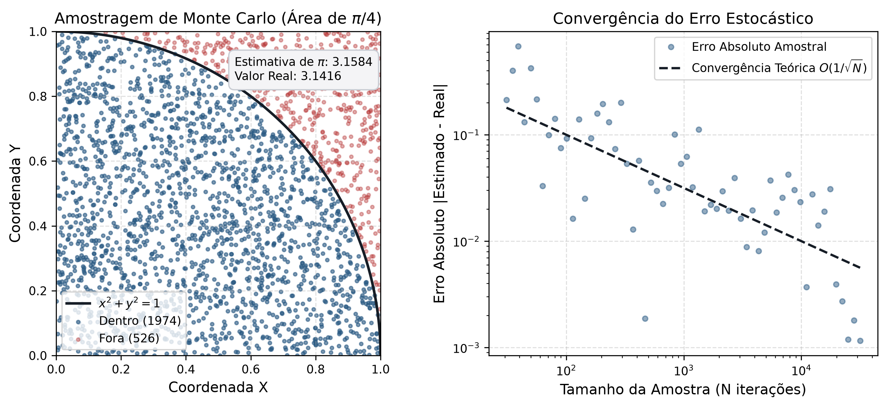
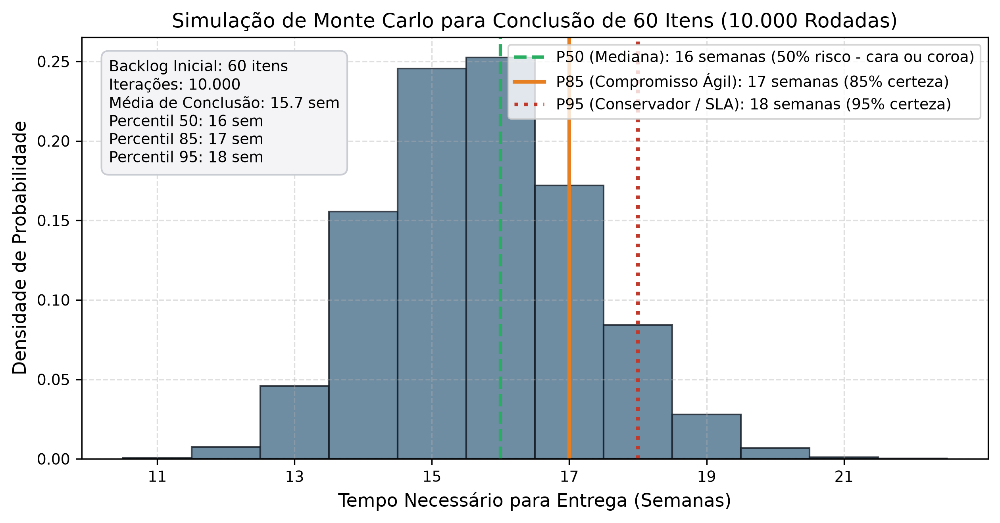

# Resumo

A previsibilidade de prazos na engenharia de software enfrenta desafios estruturais quando fundamentada em estimativas determinísticas, como soma de horas ou Story Points via Planning Poker, devido à variabilidade inerente do fluxo e às dependências probabilísticas em série. Este trabalho investiga a Simulação de Monte Carlo aplicada à previsão de prazos sob a perspectiva da Governança da Medição e do Modelo Goal-Question-Metric (GQM), em conformidade com a norma ISO/IEC/IEEE 15939. Resgatam-se as raízes físico-matemáticas do método em Los Alamos (Ulam, von Neumann e Metropolis), ilustrando o cálculo de áreas irregulares por amostragem de rejeição e a convergência estocástica $O(1/\sqrt{N})$. Demonstra-se uma aplicação prática com 10.000 iterações de *bootstrapping* não paramétrico sobre o histórico de 26 semanas de *Throughput* (102 itens validados) de uma equipe ágil, contrastando cenários de escopo fixo e escopo com expansão dinâmica (*Scope Creep*). Os resultados confirmam que compromissos respaldados em percentis estocásticos (P85 e P95) viabilizam previsões estatisticamente auditáveis e sustentáveis.

Palavras-chave: Simulação de Monte Carlo. Estimativas de Software. Throughput. Governança da Medição. Modelo GQM. ISO 15939. Previsibilidade Ágil.

# Abstract

Schedule predictability in software engineering faces structural bottlenecks when relying on deterministic point estimates, such as hour summation or Story Points via Planning Poker, due to workflow variance and serial task dependencies. This paper investigates Monte Carlo Simulation for project deadline forecasting within the framework of Measurement Governance and Victor Basili's Goal-Question-Metric (GQM) approach, compliant with the ISO/IEC/IEEE 15939 standard. We review the physical and mathematical roots of the method developed in Los Alamos by Ulam, von Neumann, and Metropolis, illustrating irregular area estimation via rejection sampling and stochastic convergence $O(1/\sqrt{N})$. An empirical study is conducted using 10,000 non-parametric bootstrap iterations over 26 weeks of historical Throughput data (102 delivered items) from an agile team, comparing fixed-scope and dynamic scope creep scenarios. The findings confirm that commitments backed by stochastic percentiles (P85 and P95) provide auditable and statistically sound delivery forecasts.

Keywords: Monte Carlo Simulation. Software Estimation. Throughput. Measurement Governance. GQM Model. ISO 15939. Agile Forecasting.

# Introdução

O planejamento temporal de empreendimentos de software tem sido historicamente caracterizado por expressivas distorções entre expectativas gerenciais e resultados empíricos [@cockburn2006]. Por décadas, a indústria recorreu a estimativas determinísticas baseadas na decomposição analítica de tarefas, na ponderação pontual em horas homem ou na adoção de métodos ágeis relativos, a exemplo de Story Points arbitrados por Planning Poker [@anderson2010]. Contudo, a experiência prática e os estudos estatísticos revelam que somar médias ou medianas de estimativas individuais conduz sistematicamente ao atraso de cronogramas [@savage2009]. Esse fenômeno decorre da natureza estocástica do fluxo de desenvolvimento, no qual interrupções, bloqueios imprevistos, dívida técnica, variação da capacidade produtiva e retrabalho introduzem assimetrias severas e distribuições com caudas longas.

Nesse contexto, a Unidade VI do componente curricular de Engenharia de Software enfatiza a Governança da Medição, o Modelo Goal-Question-Metric (GQM) e a Análise de Dados como alicerces indispensáveis para a tomada de decisão fundamentada em evidências [@basili1994; @goodhart1975; @iso15939]. A governança da medição estabelece que os dados coletados no ciclo de vida de desenvolvimento devem possuir rigor operacional, rastreabilidade e integridade matemática, prevenindo distorções comportamentais decorrentes da Lei de Goodhart, segundo a qual uma métrica que se torna meta perde seu valor informativo.

A Simulação de Monte Carlo surge como a solução matematicamente sólida para superar as limitações das estimativas subjetivas [@magennis2011; @vacanti2015]. Ao invés de demandar estimativas antecipadas e especulativas sobre a complexidade intrínseca de cada item de backlog, o método estocástico utiliza o registro histórico da vazão real entregue (*Throughput*) para simular dezenas de milhares de trajetórias futuras possíveis [@siderova2020]. A resposta obtida não é uma data única ilusória, mas uma distribuição cumulativa de probabilidades que permite quantificar os níveis de risco associados a cada prazo de entrega [@day2019; @fatto2021].

O objetivo deste artigo é formalizar a aplicação da Simulação de Monte Carlo para a previsão de prazos em projetos de software sob a ótica da governança de métricas. O trabalho estabelece as conexões entre a gênese físico-matemática da simulação e sua transposição para os sistemas sócio-técnicos de engenharia de software, estrutura o plano de coleta e análise por meio do modelo GQM em conformidade com a norma ISO/IEC/IEEE 15939, implementa um experimento computacional com dados empíricos de 26 semanas e analisa criticamente as implicações estratégicas na negociação de contratos e acordos de nível de serviço (SLA).

# Fundamentação Teórico-Matemática

A compreensão rigorosa da Simulação de Monte Carlo exige a exploração de suas raízes históricas e fundamentos probabilísticos, demonstrando por que o método constitui uma ferramenta universal de resolução numérica de incertezas complexas [@metropolis1949].

## Origens Históricas: Da Física Nuclear aos Cassinos de Mônaco

O método de Monte Carlo foi concebido na década de 1940 no Laboratório Nacional de Los Alamos por Stanislaw Ulam, John von Neumann e Nicholas Metropolis durante o Projeto Manhattan [@metropolis1949]. Conforme relata a literatura clássica, a intuição primordial surgiu quando Ulam, convalescendo de uma intervenção cirúrgica, tentava calcular a probabilidade exata de vitória em um jogo de cartas de paciência. Diante da intratabilidade combinatória analítica decorrente das múltiplas permutações possíveis, Ulam percebeu que seria metodologicamente viável simular centenas de partidas sucessivas com distribuições aleatórias e computar a frequência relativa das vitórias.

Transpondo essa percepção aos desafios bélicos da época, Ulam compartilhou a formulação com von Neumann para solucionar a difusão e multiplicação de nêutrons em materiais físseis. A modelagem física envolvia equações integro-diferenciais de transporte de Boltzmann cuja resolução analítica era inviável devido à geometria complexa dos núcleos e às seções de choque probabilísticas de colisão e absorção atômica. Metropolis sugeriu o codinome "Monte Carlo" em alusão ao célebre cassino do Principado de Mônaco, onde o tio de Ulam costumava apostar dinheiro na roleta, simbolizando a exploração sistemática do acaso para gerar estimativas precisas.

## Cálculo de Áreas e Integração Estocástica (Método de Rejeição)

Uma das aplicações geométricas mais elementares e ilustrativas da simulação de Monte Carlo consiste no cálculo de áreas sob curvas e superfícies irregulares através do método de rejeição (*Hit-or-Miss Sampling*). 

Considere uma região arbitrária bidimensional $\Omega$ delimitada no interior de um retângulo de referência $R = [x_{\min}, x_{\max}] \times [y_{\min}, y_{\max}]$ de área conhecida $A_R = (x_{\max} - x_{\min})(y_{\max} - y_{\min})$. Para determinar numericamente a área desconhecida $A_\Omega$, sorteiam-se $N$ pontos aleatórios bidimensionais $(X_i, Y_i)$ com distribuição uniforme contínua $U(R)$. Define-se a variável indicadora de pertencimento:

```latex
\begin{equation}
I_i = \begin{cases} 1, & \text{se } (X_i, Y_i) \in \Omega \\ 0, & \text{se } (X_i, Y_i) \notin \Omega \end{cases}
\end{equation}
```

O estimador estocástico da área desconhecida $\hat{A}_\Omega$ é dado pelo produto da área do retângulo de amostragem pela razão entre o número de pontos aceitos ($N_{\text{dentro}}$) e o total de iterações ($N$):

```latex
\begin{equation}
\hat{A}_\Omega = A_R \cdot \frac{1}{N} \sum_{i=1}^{N} I_i = A_R \cdot \frac{N_{\text{dentro}}}{N}
\end{equation}
```

Pela Lei Forte dos Grandes Números (LFGN), o estimador amostral converge quase certamente para o parâmetro populacional verdadeiro à medida que o volume de iterações tende ao infinito:

```latex
\begin{equation}
P\left( \lim_{N \to \infty} \hat{A}_\Omega = A_\Omega \right) = 1
\end{equation}
```

Além disso, pelo Teorema do Limite Central (TLC), o erro padrão da estimativa decresce proporcionalmente ao inverso da raiz quadrada do número de iterações, ou seja, $O(1/\sqrt{N})$. Essa propriedade confere ao método de Monte Carlo uma vantagem substancial frente às técnicas de integração numérica determinística de Newton-Cotes ou Simpson quando a dimensionalidade do espaço amostral se eleva ($d > 3$), visto que os métodos de quadratura sofrem a "maldição da dimensionalidade" com convergência proporcional a $O(N^{-1/d})$.

A Figura 1 ilustra a amostragem de Monte Carlo executada para estimar a área do círculo unitário e o valor da constante $\pi$, acompanhada da curva empírica de redução de erro amostral em escala logarítmica.



Didaticamente, essa técnica de integração numérica por rejeição é consagrada no ensino da física computacional através do problema clássico do "cálculo da área de um lago irregular": quando se deseja mensurar a superfície de um lago de contornos sinuosos e não analíticos contido em um terreno retangular delimitado de dimensões conhecidas, basta sortear uniformemente milhares de coordenadas cartesianas (análogas a gotas de chuva ou disparos aleatórios sobre a região). A razão entre o número de impactos na água e o total de disparos, multiplicada pela área retangular total, converge com exatidão para a área do lago. 

O mesmo fundamento rege a mecânica matemática dos cassinos e jogos de azar (roleta, dados e blackjack): embora o resultado de cada aposta individual seja puramente aleatório e imprevisível, a agregação cumulativa de dezenas de milhares de jogadas converge inevitavelmente para a expectativa matemática estocástica calculada (*house edge*). Ao transportar esses princípios para a engenharia de software, cada semana de trabalho da equipe atua como um sorteio estocástico de sua capacidade produtiva real, e o tempo necessário para esgotar o backlog pendente corresponde ao cômputo das iterações estocásticas exigidas para atingir a entrega total sob diferentes níveis de confiança.

## A Falha Matemática das Estimativas Determinísticas em Software

A transposição das ferramentas de previsão para a engenharia de software evidencia por que os cronogramas estabelecidos por abordagens tradicionais fracassam de maneira previsível. Conforme demonstrado por Sam Savage [@savage2009] no clássico princípio *The Flaw of Averages*, planos fundamentados em médias pressupõem implicitamente que as condições operacionais se comportarão, em média, exatamente como previsto. Todavia, em processos sujeitos a variações estocásticas e não linearidades, o resultado da média não equivale à média dos resultados:

```latex
\begin{equation}
E[f(X)] \neq f(E[X])
\end{equation}
```

No desenvolvimento de sistemas, as dependências sequenciais entre tarefas agravam drasticamente a assimetria das probabilidades [@day2019]. Considere uma cadeia simples de $n$ atividades encadeadas sem folga, em que cada tarefa possui uma estimativa pontual individual com probabilidade de cumprimento de 75% ($p = 0,75$). A probabilidade conjunta de entrega de todo o bloco no prazo nominal corresponde ao produtório das probabilidades individuais:

```latex
\begin{equation}
P(\text{Conclusão Conjunta}) = \prod_{k=1}^{n} p_k = (0,75)^n
\end{equation}
```

Para uma cadeia contendo apenas $n = 10$ atividades dependentes, a probabilidade real de o projeto cumprir a data somada das estimativas individuais despenca para:

```latex
\begin{equation}
P(\text{Sucesso}) = (0,75)^{10} \approx 0,0563 \quad (5,63\%)
\end{equation}
```

Esse cálculo formal elucida a armadilha do determinismo: embora o analista acredite estar estabelecendo prazos com 75% de confiança em cada item, o projeto como um todo apresenta 94,37% de probabilidade de atraso [@day2019].

## Métricas de Fluxo Contínuo e a Lei de Little

A alternativa metodológica sólida repousa nas métricas do fluxo de valor originadas no Sistema Toyota de Produção e adaptadas para o contexto do Kanban e do Scrum por Anderson [@anderson2010] e Vacanti [@vacanti2015]. O processo produtivo de software é caracterizado por três grandezas fundamentais:

1. **Throughput (Vazão):** Quantidade de itens de trabalho (histórias de usuário, requisitos ou correções de defeitos) concluídos e validados segundo o critério de pronto (*Definition of Done*) por unidade de tempo (geralmente medida em dias ou semanas);
2. **Work In Progress (WIP - Trabalho em Progresso):** Quantidade de itens em desenvolvimento simultâneo entre o ponto de compromisso de início e o ponto de entrega final;
3. **Cycle Time (Tempo de Ciclo):** Intervalo de tempo transcorrido desde o início da implementação de um item específico até a sua conclusão e disponibilização em produção.

Sob condições de estabilidade operacional, em que a taxa média de chegada de novos itens equilibra-se com a taxa de saída e a idade média do trabalho em progresso permanece controlada, o fluxo obedece à célebre Lei de Little formulada por John Little [@little1961]:

```latex
\begin{equation}
\text{WIP} = \text{Throughput} \times \text{Cycle Time}
\end{equation}
```

Diferentemente de métricas subjetivas de esforço, o Throughput representa uma grandeza factual, observável e imune a manipulações arbitrárias [@vacanti2015]. 

## Fragilidade dos Story Points e a Lei de Goodhart

O emprego disseminado de Story Points e Velocity como mecanismos primários de estimativa ágil apresenta sérias vulnerabilidades sob a ótica da governança [@siderova2020]. Story Points constituem estimativas abstratas e ordinais de esforço relativo, fundamentadas no consenso de equipes durante sessões de Planning Poker. Contudo, essa prática incorre em três falhas críticas:

1. **Incomensurabilidade e arbitrariedade:** O valor numérico de um Story Point não possui vínculo com uma grandeza física invariante no Sistema Internacional de Unidades, variando significativamente entre membros da equipe e oscilando ao longo do tempo;
2. **Ignorância da dispersão estatística:** O "Velocity" é rotineiramente calculado como a média aritmética simples dos pontos entregues por sprint. Esse procedimento mascara a variância, ignora a assimetria das distribuições reais de entrega e supõe equivocadamente uma curva gaussiana perfeitamente simétrica;
3. **Vulnerabilidade à Lei de Goodhart [@goodhart1975]:** Uma vez que o Velocity da equipe passa a ser monitorado pela gestão como indicador de desempenho ou produtividade, os desenvolvedores tendem involuntariamente ou estrategicamente a inflacionar a pontuação de histórias para demonstrar evolução fictícia de velocidade, sem que haja qualquer incremento na taxa real de software entregue.

Ao adotar o Throughput semanal como medida empírica primária e modelar o processo por meio de Monte Carlo, a equipe abandona o debate especulativo sobre pontuações relativas e passa a operar sobre a cadência real de entrega da organização [@magennis2011].

# Governança da Medição: O Modelo GQM na Previsão de Software

Para assegurar a validade e a integridade da medição, aplica-se o modelo Goal-Question-Metric (GQM), formulado por Victor Basili [@basili1994], e harmonizado com a norma internacional ISO/IEC/IEEE 15939 [@iso15939].

## Estruturação da Árvore GQM

O modelo GQM estrutura a governança através de três níveis conceituais: Meta Conceitual (Goal), Questões Operacionais (Questions) e Métricas Mensuráveis (Metrics). A Tabela 1 detalha a modelagem adotada para a previsão de prazos estocásticos.

Tabela: Estrutura do Modelo GQM para Previsão de Prazos de Software
| Nível | ID | Descrição Operacional |
| --- | --- | --- |
| Objetivo (Goal) | G1 | Analisar o processo de entrega contínua com a finalidade de prever prazos de releases sob a perspectiva da engenharia e diretoria no contexto do Centro Universitário FAMETRO. |
| Questão (Question) | Q1 | Qual é o comportamento estatístico da vazão histórica (Throughput) da equipe e seu grau de dispersão? |
| Questão (Question) | Q2 | Qual a probabilidade cumulativa de entregar um backlog de 60 itens em diferentes horizontes temporais? |
| Questão (Question) | Q3 | Como a taxa de expansão de escopo (*Scope Creep*) desloca as curvas de confiança de prazo? |
| Questão (Question) | Q4 | Quais percentis de confiança devem respaldar compromissos contratuais e marcos estratégicos? |
| Métrica (Metric) | M1 | Histórico semanal de Throughput: número de itens entregues e validados por semana ($T_w$). |
| Métrica (Metric) | M2 | Tamanho do Backlog Remanescente: contagem de itens priorizados aguardando execução ($S$). |
| Métrica (Metric) | M3 | Distribuição de probabilidade cumulativa das semanas de conclusão via 10.000 iterações de Monte Carlo. |
| Indicador | IND1 | Percentil 85 (P85) de conclusão para acordos operacionais com a equipe e stakeholders. |
| Indicador | IND2 | Percentil 95 (P95) de conclusão para compromissos com penalidade financeira e dependências críticas. |

## Conformidade com a ISO/IEC/IEEE 15939

O processo implementado atende rigorosamente às diretrizes da norma ISO/IEC/IEEE 15939 [@iso15939], que prescreve o ciclo de vida da medição em quatro atividades: Planejar a Medição, Executar a Medição, Avaliar a Medição e Sustentar o Processo. Assegura-se que:

- A medida base (Throughput) seja extraída diretamente de registros auditáveis de controle de versão e ferramentas de acompanhamento de fluxo (ex.: GitHub Issues, GitLab ou Jira), eliminando estimativas autodeclaradas;
- Os procedimentos analíticos de bootstrapping sejam transparentes, reprodutíveis e apoiados em algoritmos públicos e bibliotecas de código aberto (`rodbv/quando` e `thawkin3/monte-carlo-simulation-project-timeline-estimator`) [@rodbv2023; @thawkin2022];
- Os relatórios gerenciais declarem explicitamente o nível de risco associado a cada percentil de probabilidade, prevenindo a falsa segurança de previsões pontuais.

# Estudo de Caso e Aplicação Prática

A aplicação prática foi conduzida a partir do registro de entregas de uma equipe multidisciplinar de desenvolvimento de software ao longo de 26 semanas consecutivas de operação (correspondente a um semestre letivo completo).

## Coleta de Dados e Caracterização do Throughput Histórico

A Tabela 2 apresenta o registro cronológico da vazão semanal da equipe, totalizando 102 itens de trabalho concluídos e homologados segundo a *Definition of Done*.

Tabela: Histórico Semanal de Throughput (26 semanas consecutivas)
| Semana | Vazão | Semana | Vazão |
| --- | --- | --- | --- |
| Semana 01 | 4 itens | Semana 14 | 5 itens |
| Semana 02 | 3 itens | Semana 15 | 4 itens |
| Semana 03 | 5 itens | Semana 16 | 3 itens |
| Semana 04 | 2 itens | Semana 17 | 7 itens |
| Semana 05 | 4 itens | Semana 18 | 4 itens |
| Semana 06 | 6 itens | Semana 19 | 2 itens |
| Semana 07 | 3 itens | Semana 20 | 5 itens |
| Semana 08 | 1 item | Semana 21 | 3 itens |
| Semana 09 | 5 itens | Semana 22 | 4 itens |
| Semana 10 | 4 itens | Semana 23 | 6 itens |
| Semana 11 | 3 itens | Semana 24 | 2 itens |
| Semana 12 | 6 itens | Semana 25 | 4 itens |
| Semana 13 | 2 itens | Semana 26 | 5 itens |
| **Total** | **102 itens** | **Média Semanal** | **3,92 itens/sem** |

A análise descritiva desse conjunto amostral revela uma média de 3,92 itens entregues por semana, com desvio padrão amostral de 1,49 itens, valor mínimo de 1 item e máximo de 7 itens por semana. A Figura 2 apresenta a distribuição de frequências observada.


Nota-se claramente que a distribuição não exibe perfil estritamente normal, apresentando assimetria moderada decorrente de períodos de bloqueio operacional externo e oscilações de fluxo.

## Algoritmo de Bootstrapping Não Paramétrico

Para simular o tempo requerido para concluir um backlog de 60 itens novos priorizados, utilizou-se um algoritmo estocástico de *bootstrapping* não paramétrico implementado em Python [@rodbv2023]. O procedimento consiste em:

1. Fixar o volume do backlog pendente $B_0 = 60$ itens;
2. Para cada iteração $r \in \{1, 2, \dots, 10.000\}$:
   - Inicializar o contador temporal $t = 0$;
   - Enquanto o backlog pendente for estritamente superior a zero ($B_t > 0$):
     * Incrementar a contagem de semanas $t \leftarrow t + 1$;
     * Sortear aleatoriamente, com reposição e probabilidade uniforme $1/26$, um valor de vazão $T_t$ do vetor histórico de 26 semanas;
     * Subtrair a vazão sorteada do saldo remanescente: $B_t \leftarrow B_{t-1} - T_t$;
   - Registrar as semanas necessárias na iteração $D_r = t$;
3. Ordenar o vetor de desfechos simulados $[D_1, D_2, \dots, D_{10.000}]$ e calcular os percentis de confiança empíricos.

Para contemplar a dinâmica real de projetos, modelaram-se dois cenários comparativos:

- **Cenário A (Escopo Fixo):** O backlog permanece congelado em exatamente 60 itens até a conclusão total;
- **Cenário B (Escopo Dinâmico com Scope Creep):** A cada semana transcorrida, há probabilidade estocástica de surgimento de novos itens decorrentes de desdobramentos de requisitos ou defeitos identificados em testes. Modelou-se uma taxa semanal de descoberta de novos itens sorteada de acordo com as seguintes probabilidades empíricas: 0 novos itens (50%), 1 novo item (35%) e 2 novos itens (15%), resultando em uma taxa média de expansão de escopo de $+0,65$ itens adicionais por semana.

## Resultados da Simulação

A Tabela 3 consolida as métricas estatísticas geradas após a execução de 10.000 rodadas de simulação computacional para ambos os cenários.

Tabela: Resultados Estatísticos Comparativos da Simulação de Monte Carlo (10.000 rodadas)
| Parâmetro Estatístico | Cenário A (Escopo Fixo) | Cenário B (Escopo Dinâmico) | Variação Absoluta |
| --- | --- | --- | --- |
| Tamanho Inicial do Backlog | 60 itens | 60 itens | 0 |
| Média Aritmética de Prazos | 15,73 semanas | 18,85 semanas | +3,12 semanas |
| Desvio Padrão Amostral | 1,50 semanas | 2,17 semanas | +0,67 semanas |
| Percentil 50 (P50 - Mediana) | 16 semanas | 19 semanas | +3 semanas |
| Percentil 75 (P75) | 17 semanas | 20 semanas | +3 semanas |
| Percentil 85 (P85 - Compromisso) | 17 semanas | 21 semanas | +4 semanas |
| Percentil 95 (P95 - Conservador) | 18 semanas | 23 semanas | +5 semanas |
| Prazo Mínimo Simulado | 11 semanas | 12 semanas | +1 semana |
| Prazo Máximo Simulado | 22 semanas | 28 semanas | +6 semanas |

A Figura 3 expõe o histograma de distribuição de probabilidades para o Cenário A, destacando os percentis de confiança P50, P85 e P95.



A representação executiva de maior relevância gerencial é obtida por meio da Curva S (Função de Distribuição Cumulativa - CDF), que correlaciona diretamente o prazo pretendido com o percentual de certeza estatística de cumprimento. A Figura 4 apresenta as Curvas S dos Cenários A e B sobrepostas.


A análise gráfica ilustra com clareza o deslocamento das curvas promovido pelo *Scope Creep*: para assegurar o mesmo nível de 85% de confiança de entrega, a presença de uma taxa média de acréscimo de 0,65 itens/semana posterga a data de entrega de 17 semanas para 21 semanas (acréscimo de 4 semanas de trabalho da equipe).

# Análise Crítica e Discussão

Os resultados obtidos fornecem subsídios substantivos para a tomada de decisão em nível gerencial e desconstroem práticas inadequadas de planejamento [@magennis2011; @vacanti2015].

## A Falácia do P50 como Compromisso de Engenharia

Na cultura corporativa convencional, gestores e equipes frequentemente assumem a média ou o percentil 50 (P50) como a data oficial prometida a clientes e patrocinadores de projetos. No experimento realizado no Cenário A, o P50 estabelece o prazo de 16 semanas. 

Contudo, comprometer-se com o percentil P50 implica, por definição conceitual de mediana, aceitar que existe exatamente 50% de probabilidade de o projeto ser concluído até aquela data e 50% de chance de atraso. Prometer prazos com base no P50 equivale matematicamente a apostar o sucesso de um contrato no lançamento de uma moeda não viciada (cara ou coroa).

No âmbito da governança de software, recomenda-se adotar o percentil 85 (P85) como parâmetro para compromissos internos de equipe e planejamento de capacidade operacional [@siderova2020]. O P85 assegura que, em 85 de cada 100 trajetórias plausíveis de futuro simuladas a partir do histórico real, a entrega ocorrerá dentro do limite estipulado, reservando um risco residual de apenas 15%. Para contratos comerciais de escopo fechado envolvendo sanções financeiras pesadas, penalidades de SLA ou janelas estritas de regulamentação governamental, a literatura recomenda o emprego do percentil 95 (P95) [@vacanti2015].

## Análise de Sensibilidade e Volume Amostral

A estabilidade estatística do método de Monte Carlo depende criticamente da representatividade da amostra histórica de Throughput. Conforme demonstrado por Sonya Siderova [@siderova2020] e Troy Magennis [@magennis2011], amostras inferiores a 10 observações temporais geram intervalos de confiança excessivamente amplos devido à sensibilidade a eventos extremos (*outliers*).

Recomenda-se como diretriz de governança coletar entre 20 e 30 observações históricas consecutivas (ex.: 20 a 30 semanas) para respaldar o *bootstrapping*. Esse horizonte amostral é suficientemente amplo para capturar a dispersão natural do fluxo (feriados, manutenções emergenciais, ausências de integrantes e gargalos pontuais) e, ao mesmo tempo, suficientemente restrito para refletir a composição tecnológica e a maturidade da equipe atual.

## Premissas de Validade e Condições de Contorno

Para que a Simulação de Monte Carlo produza previsões válidas e confiáveis, o processo de software deve satisfazer a premissas operacionais bem delimitadas:

1. **Estacionariedade do Processo:** O comportamento futuro da equipe deve ser razoavelmente similar ao comportamento registrado no período histórico utilizado. Mudanças radicais na arquitetura tecnológica, rotatividade substancial de colaboradores ou alterações drásticas na política de testes invalidam a representatividade da base amostral;
2. **Granularidade do Trabalho:** Os itens de backlog não precisam possuir exatamente o mesmo tamanho de esforço (visto que a simulação incorpora naturalmente a variação de tamanhos), porém não devem conter disparidades desproporcionais, a exemplo de épicos de meses misturados a tarefas triviais de minutos. A recomendação ágil reside na quebra de histórias até que representem parcelas testáveis e independentes de valor;
3. **Controle Rigoroso do WIP:** A Lei de Little estabelece que o Throughput só permanece estável se o Trabalho em Progresso for delimitado. A proliferação desordenada de tarefas concorrentes alonga o Cycle Time e colapsa a vazão semanal, introduzindo variância espúria no sistema de medição.

# Considerações Finais

A governança da medição em engenharia de software exige a substituição de estimativas determinísticas intuitivas por métodos científicos quantitativos ancorados na análise rigorosa de dados. A Simulação de Monte Carlo atende a essa exigência ao conectar as fundações da mecânica estatística desenvolvidas em Los Alamos aos desafios modernos de previsão de entregas em projetos ágeis.

Neste artigo, demonstrou-se formalmente que somar médias individuais conduz à falácia das estimativas encadeadas, resultando em probabilidades reais de cumprimento de cronograma inferiores a 6% em cadeias de dependências sequenciais. Em contrapartida, ao estruturar o programa de medição segundo o modelo Goal-Question-Metric (GQM) e os requisitos da norma ISO/IEC/IEEE 15939, estabeleceu-se a vazão histórica (Throughput) como medida factual primária para a simulação de 10.000 futuros possíveis.

O estudo experimental com 26 semanas de histórico evidenciou que a entrega de 60 itens atinge o nível padrão de 85% de confiança em 17 semanas sob escopo congelado, estendendo-se para 21 semanas quando se incorpora a dinâmica realista de expansão de escopo (*Scope Creep*). A visualização gerencial por meio da Curva S cumulativa viabiliza negociações transparentes entre engenharia e lideranças corporativas, capacitando os gestores a substituir promessas irrealistas de 50% de confiança por compromissos estocásticos auditáveis e resilientes.

# Referências

- [anderson2010] ANDERSON, David J. *Kanban: Successful Evolutionary Change for Your Technology Business*. Sequim: Blue Hole Press, 2010.
- [basili1994] BASILI, Victor R.; CALDIERA, Gianluigi; ROMBACH, H. Dieter. The Goal Question Metric Approach. *Encyclopedia of Software Engineering*, v. 2, p. 528-532, 1994.
- [cockburn2006] COCKBURN, Alistair. *Agile Software Development: The Cooperative Game*. 2. ed. Boston: Addison-Wesley, 2006.
- [day2019] DAY, Benjamin. When Will It Be Done? Monte Carlo Forecasting Explained. *Benjamin Day Consulting*, Boston, 2019.
- [fatto2021] FATTO CONSULTORIA. *Simulação de Monte Carlo nas Estimativas de Projetos de Software*. Brasília: Fatto Consultoria e Sistemas, 2021.
- [goodhart1975] GOODHART, Charles A. E. Problems of Monetary Management: The U.K. Experience. *Papers in Monetary Economics*, Sydney: Reserve Bank of Australia, v. 1, p. 1-22, 1975.
- [iso15939] INTERNATIONAL ORGANIZATION FOR STANDARDIZATION. *ISO/IEC/IEEE 15939: Systems and software engineering -- Measurement process*. Genebra: ISO, 2017.
- [little1961] LITTLE, John D. C. A Proof for the Queuing Formula: $L = \lambda W$. *Operations Research*, Catonsville: INFORMS, v. 9, n. 3, p. 383-387, 1961.
- [magennis2011] MAGENNIS, Troy. *Forecasting and Simulating Software Development Projects: Effective Modeling of Kanban and Scrum Projects using Monte Carlo Simulation*. Seattle: Focused Objective, 2011.
- [metropolis1949] METROPOLIS, Nicholas; ULAM, Stanislaw. The Monte Carlo Method. *Journal of the American Statistical Association*, v. 44, n. 247, p. 335-341, 1949.
- [rodbv2023] RODBV. *Quando: Service Level Expectations and Monte Carlo Forecasting Library in Python*. Repositório GitHub, 2023. Disponível em: https://github.com/rodbv/quando. Acesso em: 18 nov. 2026.
- [savage2009] SAVAGE, Sam L. *The Flaw of Averages: Why We Underestimate Risk in the Face of Uncertainty*. Hoboken: John Wiley and Sons, 2009.
- [siderova2020] SIDEROVA, Sonya. Continuous Forecasting with Monte Carlo: Why Story Points Fail at Scale. *Agile Austin Conference*, Austin, 2020.
- [thawkin2022] HAWKINS, Tyler. *Monte Carlo Simulation Project Timeline Estimator*. Repositório GitHub, 2022. Disponível em: https://github.com/thawkin3/monte-carlo-simulation-project-timeline-estimator. Acesso em: 18 nov. 2026.
- [vacanti2015] VACANTI, Daniel S. *When Will It Be Done? Lean-Agile Forecasting to Answer Your Customers' Most Important Question*. Boca Raton: ActionableAgile, 2015.
