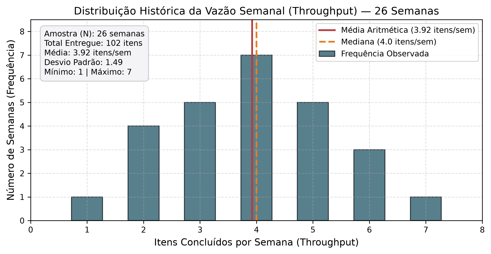
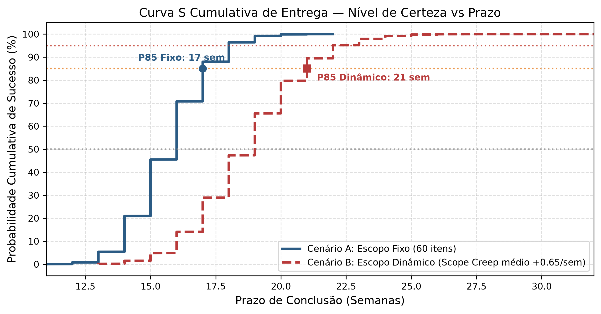
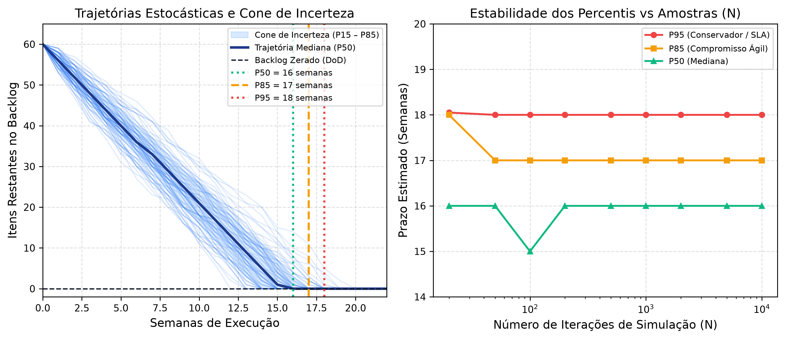
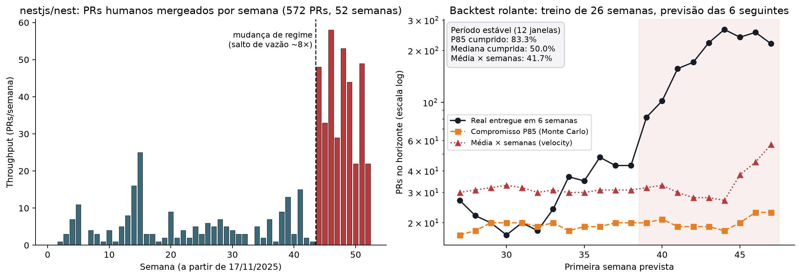

# Resumo

A previsibilidade de prazos na engenharia de software enfrenta desafios estruturais quando fundamentada em estimativas determinísticas, como soma de horas ou Story Points via Planning Poker, devido à variabilidade inerente do fluxo e às dependências probabilísticas em série. Este trabalho investiga a Simulação de Monte Carlo aplicada à previsão de prazos sob a perspectiva da Governança da Medição e do Modelo Goal-Question-Metric (GQM), em conformidade com a norma ISO/IEC/IEEE 15939. Resgatam-se as raízes físico-matemáticas do método em Los Alamos (Ulam, von Neumann e Metropolis), ilustrando o cálculo de áreas irregulares por amostragem de rejeição e a convergência estocástica $O(1/\sqrt{N})$. Demonstra-se uma aplicação prática com 10.000 iterações de *bootstrapping* não paramétrico sobre o histórico de 26 semanas de *Throughput* (102 itens validados) de uma equipe ágil, contrastando cenários de escopo fixo e escopo com expansão dinâmica (*Scope Creep*), com motor implementado em TypeScript e conferido pela aproximação analítica do Teorema Central do Limite para processos de renovação. Para testar o método fora do exemplo didático, aplicou-se um *backtest* rolante a 572 *pull requests* mergeados em 52 semanas no repositório de grande porte `nestjs/nest`: no período estável, o compromisso P85 foi cumprido em 83,3% das janelas, a mediana em 50,0% e a projeção por média (lógica da *velocity*) em apenas 41,7%. Os resultados confirmam que compromissos respaldados em percentis estocásticos (P85 e P95) viabilizam previsões estatisticamente auditáveis e sustentáveis.

Palavras-chave: Simulação de Monte Carlo. Estimativas de Software. Throughput. Backtesting. Governança da Medição. Modelo GQM. ISO 15939. Previsibilidade Ágil.

# Abstract

Schedule predictability in software engineering faces structural bottlenecks when relying on deterministic point estimates, such as hour summation or Story Points via Planning Poker, due to workflow variance and serial task dependencies. This paper investigates Monte Carlo Simulation for project deadline forecasting within the framework of Measurement Governance and Victor Basili's Goal-Question-Metric (GQM) approach, compliant with the ISO/IEC/IEEE 15939 standard. We review the physical and mathematical roots of the method developed in Los Alamos by Ulam, von Neumann, and Metropolis, illustrating irregular area estimation via rejection sampling and stochastic convergence $O(1/\sqrt{N})$. An empirical study is conducted using 10,000 non-parametric bootstrap iterations over 26 weeks of historical Throughput data (102 delivered items) from an agile team, comparing fixed-scope and dynamic scope creep scenarios, with a TypeScript engine cross-checked against the renewal-process Central Limit Theorem. A rolling backtest over 572 merged pull requests from the large open-source repository `nestjs/nest` (52 weeks) shows that, in the stationary period, the P85 commitment held in 83.3% of windows, the median in 50.0%, and average-based projection (velocity logic) in only 41.7%. The findings confirm that commitments backed by stochastic percentiles (P85 and P95) provide auditable and statistically sound delivery forecasts.

Keywords: Monte Carlo Simulation. Software Estimation. Throughput. Backtesting. Measurement Governance. GQM Model. ISO 15939. Agile Forecasting.

# Introdução

O planejamento temporal de projetos de software é historicamente marcado por grandes distorções entre expectativa e resultado [@cockburn2006]. A indústria recorre a estimativas determinísticas, seja pela decomposição de tarefas em horas, seja por Story Points arbitrados em Planning Poker [@anderson2010]. Contudo, somar médias de estimativas individuais conduz sistematicamente ao atraso [@savage2009], porque interrupções, bloqueios, dívida técnica e retrabalho tornam o fluxo de desenvolvimento estocástico, com distribuições assimétricas e caudas longas.

A Unidade VI da disciplina enfatiza a Governança da Medição, o Modelo Goal-Question-Metric (GQM) e a Análise de Dados como base da decisão fundamentada em evidências [@basili1994; @iso15939]. A governança exige que os dados de medição sejam rastreáveis e íntegros, prevenindo a Lei de Goodhart, segundo a qual uma métrica que se torna meta perde seu valor informativo [@goodhart1975].

A Simulação de Monte Carlo responde a essa exigência [@magennis2011; @vacanti2018]. Em vez de estimar antecipadamente a complexidade de cada item, o método usa o registro histórico da vazão real (*Throughput*) para simular milhares de futuros possíveis [@siderova2025]. A resposta não é uma data única, mas uma distribuição de probabilidades que quantifica o risco de cada prazo [@day2026; @fatto2020].

O objetivo deste trabalho é aplicar a Simulação de Monte Carlo à previsão de prazos sob a ótica da governança de métricas. As contribuições são quatro: (1) um motor reprodutível em TypeScript, com semente fixa e 15 testes automatizados, que reproduz os percentis das implementações `rodbv/quando` e `thawkin3` [@rodbv2026; @thawkin2026]; (2) a conferência da simulação por uma fórmula fechada do Teorema Central do Limite para processos de renovação [@ross1996]; (3) a quantificação da precisão da própria simulação pela desigualdade de Dvoretzky-Kiefer-Wolfowitz [@dkw1956; @massart1990]; e (4) uma curadoria de implementações abertas e um *backtest* com dados reais do projeto `nestjs/nest` [@nestjs2026].

# Fundamentação Teórica

## Origem do Método e Cálculo de Áreas por Rejeição

O método de Monte Carlo foi concebido na década de 1940 no Laboratório Nacional de Los Alamos por Stanislaw Ulam, John von Neumann e Nicholas Metropolis, durante o Projeto Manhattan [@metropolis1949]. Ulam, convalescendo de uma cirurgia, tentava calcular a probabilidade de vitória em um jogo de paciência; diante da intratabilidade combinatória, percebeu que bastava simular muitas partidas e contar a frequência das vitórias. Com von Neumann, aplicou a ideia à difusão de nêutrons em materiais físseis, cujas equações de transporte não tinham solução analítica viável. Metropolis sugeriu o codinome "Monte Carlo" em alusão ao cassino de Mônaco, onde o tio de Ulam apostava na roleta.

A aplicação geométrica mais ilustrativa é o cálculo de áreas pelo método de rejeição (*Hit-or-Miss Sampling*). Sorteiam-se $N$ pontos uniformes em um retângulo $R$ de área conhecida $A_R$ que envolve uma região irregular $\Omega$, e conta-se quantos caem dentro dela ($N_{\text{dentro}}$):

```latex
\begin{equation}
\hat{A}_\Omega = A_R \cdot \frac{N_{\text{dentro}}}{N}
\end{equation}
```

Pela Lei Forte dos Grandes Números, $\hat{A}_\Omega$ converge quase certamente para a área verdadeira, e pelo Teorema do Limite Central o erro padrão decresce em $O(1/\sqrt{N})$, independentemente da dimensão do problema. Por isso o método supera as quadraturas determinísticas (Newton-Cotes, Simpson) em dimensões elevadas, nas quais elas convergem em $O(N^{-1/d})$. A Figura 1 ilustra a estimativa da área do círculo unitário (e de $\pi$) e a queda do erro em escala logarítmica.


Didaticamente, é o problema do "lago irregular": a fração de pontos sorteados que cai na água, vezes a área do terreno, converge para a área do lago. O mesmo rege os cassinos: cada aposta é imprevisível, mas milhares de jogadas convergem para a vantagem da casa (*house edge*). Em software, cada semana de trabalho é um sorteio da capacidade real da equipe, e o prazo é o número de sorteios necessários para esgotar o backlog.

## A Falha das Estimativas Determinísticas e dos Story Points

Conforme o princípio *The Flaw of Averages* de Sam Savage [@savage2009], planos baseados em médias falham porque, em processos não lineares, o resultado da média não equivale à média dos resultados, $E[f(X)] \neq f(E[X])$. As dependências sequenciais agravam o problema [@day2026]: em uma cadeia de $n$ tarefas sem folga, cada uma com 75% de chance de cumprir sua estimativa, a probabilidade de entrega conjunta é

```latex
\begin{equation}
P(\text{Sucesso}) = \prod_{k=1}^{n} p_k = (0,75)^{10} \approx 0,0563 \quad (5,63\%)
\end{equation}
```

Ou seja, embora cada item tenha 75% de confiança, o bloco de 10 tarefas tem 94,37% de chance de atraso.

Story Points e Velocity agravam essa fragilidade [@siderova2025]: o ponto não tem vínculo com grandeza física e varia entre pessoas e ao longo do tempo; a Velocity, média simples, mascara a variância e a assimetria das entregas; e, cobrada como indicador de produtividade, sofre a Lei de Goodhart [@goodhart1975], pois a equipe tende a inflacionar a pontuação sem que a entrega real aumente.

## Métricas de Fluxo e a Lei de Little

A alternativa repousa nas métricas de fluxo adaptadas ao Kanban por Anderson [@anderson2010] e Vacanti [@vacanti2018]: *Throughput* (itens concluídos segundo a *Definition of Done* por unidade de tempo), *Work In Progress* (WIP, itens em andamento simultâneo) e *Cycle Time* (tempo do início à conclusão de um item). Em regime estável, essas grandezas obedecem à Lei de Little [@little1961]:

```latex
\begin{equation}
\text{WIP} = \text{Throughput} \times \text{Cycle Time}
\end{equation}
```

Diferentemente do esforço estimado, o Throughput é uma grandeza factual e observável [@vacanti2018], e por isso é a variável de entrada da simulação [@magennis2011].

## Aproximação Analítica pelo Teorema Central do Limite

Embora a simulação dispense hipóteses sobre a forma da distribuição, uma fórmula fechada serve como conferência independente. Seja $T_w$ o throughput da semana $w$, com média $\mu$ e variância $\sigma^2$, e $B$ o backlog. O prazo é $D = \min\{t : \sum_{w=1}^{t} T_w \ge B\}$. Pela teoria de processos de renovação [@ross1996], para $B$ grande o prazo é aproximadamente normal; somando meia semana pela contagem em semanas inteiras:

```latex
\begin{equation}
D \approx \mathcal{N}\left( \frac{B}{\mu} + \frac{1}{2} ,\; \frac{B\,\sigma^2}{\mu^3} \right)
\qquad \Rightarrow \qquad
P_{85} \approx \frac{B}{\mu} + \frac{1}{2} + 1{,}036 \sqrt{\frac{B\,\sigma^2}{\mu^3}}
\end{equation}
```

Em que $1,036$ é o quantil de 85% da normal padrão (para o P95, $1,645$). Duas propriedades gerenciais se destacam: a incerteza cresce com $\sqrt{B}$, de modo que dobrar o backlog dobra o prazo médio mas aumenta a folga em apenas cerca de 41%; e o *Scope Creep* entra substituindo $\mu$ pela vazão líquida $\mu - \lambda$ e a variância por $\sigma^2 + \sigma_\lambda^2$, em que $\lambda$ é a taxa média de itens novos por semana.

## Precisão da Própria Simulação: Desigualdade DKW

Toda simulação é também uma estimativa. A média dos prazos simulados tem erro padrão $\sigma_D/\sqrt{N}$. Para a Curva S inteira, a desigualdade de Dvoretzky-Kiefer-Wolfowitz, com a constante ótima de Massart [@dkw1956; @massart1990], garante que a distribuição empírica $\hat{F}_N$ se afasta da verdadeira $F$ em no máximo $\varepsilon$, em todos os pontos, com confiança $1-\alpha$:

```latex
\begin{equation}
P\left( \sup_{t} \left| \hat{F}_N(t) - F(t) \right| > \varepsilon \right) \le 2\, e^{-2N\varepsilon^2}
\qquad \Rightarrow \qquad
\varepsilon = \sqrt{\frac{\ln(2/\alpha)}{2N}}
\end{equation}
```

Com $N = 10.000$ e $\alpha = 0,05$, $\varepsilon \approx 1,36$ ponto percentual: quando a Curva S indica 85%, o valor verdadeiro está entre 83,6% e 86,4%. Com $N = 1.000$ a margem sobe para 4,29 pontos, e garantir 1 ponto exigiria 18.445 iterações. Isso justifica objetivamente as 10.000 rodadas. Essa margem mede apenas o erro do sorteio; o erro de um histórico pouco representativo do futuro não diminui com mais iterações.

## Governança da Medição: Modelo GQM e ISO/IEC/IEEE 15939

O modelo GQM de Basili [@basili1994] organiza a medição em Meta (Goal), Questões (Questions) e Métricas (Metrics). A Tabela 1 apresenta a modelagem adotada.

Tabela: Estrutura do Modelo GQM para Previsão de Prazos de Software
| Nível | Descrição Operacional |
| --- | --- |
| Objetivo (Goal) G1 | Analisar o processo de entrega contínua para prever prazos de releases, sob a perspectiva da engenharia e da diretoria. |
| Questão Q1 | Qual é o comportamento estatístico da vazão histórica (Throughput) da equipe e seu grau de dispersão? |
| Questão Q2 | Qual a probabilidade cumulativa de entregar um backlog de 60 itens em diferentes horizontes temporais? |
| Questão Q3 | Como a taxa de expansão de escopo (*Scope Creep*) desloca as curvas de confiança de prazo? |
| Questão Q4 | Quais percentis de confiança devem respaldar compromissos contratuais e marcos estratégicos? |
| Métrica M1 | Histórico semanal de Throughput: número de itens entregues e validados por semana ($T_w$). |
| Métrica M2 | Tamanho do Backlog Remanescente: contagem de itens priorizados aguardando execução ($S$). |
| Métrica M3 | Distribuição de probabilidade cumulativa das semanas de conclusão via 10.000 iterações de Monte Carlo. |
| Indicador IND1 | Percentil 85 (P85) de conclusão para acordos operacionais com a equipe e stakeholders. |
| Indicador IND2 | Percentil 95 (P95) de conclusão para compromissos com penalidade financeira e dependências críticas. |

O processo segue o ciclo da ISO/IEC/IEEE 15939 [@iso15939] (planejar, executar, avaliar e sustentar a medição): a medida base vem de registros auditáveis, e não de estimativas autodeclaradas; os procedimentos são reprodutíveis; e os relatórios declaram o risco de cada percentil.

## Implementações Open-Source de Referência

Antes de implementar o motor próprio, fez-se uma curadoria de repositórios públicos que aplicam Monte Carlo à previsão de entregas (Tabela 2, consulta em 18 nov. 2026). Há simuladores didáticos e plataformas integradas a ferramentas de gestão, todos independentes e baseados no mesmo *bootstrapping* do throughput com leitura por percentis.

Tabela: Curadoria de implementações open-source de Monte Carlo para previsão de entregas
| Projeto (autor) | Tecnologia e família | Entrada de dados | Perguntas respondidas |
| --- | --- | --- | --- |
| Kanban Monte Carlo Simulation (jabopiti) | Python, notebook didático | CSV de throughput | Quando? Quantos? |
| Kanban Metrics (jsherer) | Python, notebook didático | Histórico do Jira | Quando? e curva de sobrevivência |
| quando (rodbv) | Python, biblioteca | CSV com datas de início e fim | Quando? e SLE de cycle time |
| Timeline Estimator (thawkin3) | TypeScript, aplicação web didática | Formulário com histórico | Quando? |
| flowmetrics (dvhthomas) | Python, ferramenta de linha de comando | PRs e issues do GitHub, Jira | Quando? Quantos? métricas de fluxo |
| Professional Kanban (ProKanban) | Python, assistente de IA | CSV exportado | SLE, idade dos itens, Quando? |
| Capacity Planning and Feature Monte Carlo (nbrown02) | Power BI, plataforma | Jira e Azure DevOps | Quando cada funcionalidade fica pronta? |
| Lighthouse (LetPeopleWork) | C#, plataforma | Jira, Azure DevOps, CSV, Linear (prévia) | Quando? Quantos? portfólio |

Para estudo, os mais próximos deste trabalho são três projetos que expõem o algoritmo em poucas linhas [@jabopiti2019; @jsherer2021; @rodbv2026]. Para uso operacional, destacam-se o Lighthouse [@lighthouse2026] e o Capacity Planning and Feature Monte Carlo [@nbrown2026]. O flowmetrics [@dvhthomas2026] extrai o throughput de *pull requests* do GitHub, mesma estratégia do segundo estudo de caso.

# Metodologia e Estudo de Caso

O estudo combina dois cenários: um histórico simulado de 26 semanas, para demonstrar o método e conferi-lo analiticamente, e dados reais do repositório `nestjs/nest`, para verificar se as previsões teriam acertado.

## Cenário 1: Histórico Simulado de 26 Semanas

Os dados deste cenário são fictícios, identificados como simulados conforme a orientação da atividade, e representam uma equipe ágil ao longo de 26 semanas (um semestre). A vazão semanal, em itens concluídos segundo a *Definition of Done*, foi: 4, 3, 5, 2, 4, 6, 3, 1, 5, 4, 3, 6, 2, 5, 4, 3, 7, 4, 2, 5, 3, 4, 6, 2, 4 e 5. São 102 itens no total, com média de 3,92 itens por semana, desvio padrão amostral de 1,49, mínimo de 1 e máximo de 7. A Figura 2 mostra que a distribuição não é normal, com assimetria decorrente de semanas de bloqueio.



Para prever o prazo de um backlog de $B_0 = 60$ itens, usou-se *bootstrapping* não paramétrico [@efron1979]: em cada uma das 10.000 iterações, sorteia-se com reposição uma semana do histórico e desconta-se sua vazão do backlog até zerá-lo; o número de semanas necessárias é registrado e, ao final, calculam-se os percentis. O motor foi implementado em TypeScript (*runtime* Bun) seguindo a lógica de `rodbv/quando` [@rodbv2026]. O núcleo do arquivo `src/monte-carlo.ts` é mostrado abaixo; o gerador `criarRng` (Mulberry32) usa semente fixa, o que torna cada execução reprodutível e auditável:

```typescript
export function simularQuando(
  historico: number[],
  opcoes: OpcoesQuando,
): number[] {
  const { backlog, iteracoes = 10_000, semente = 42, scopeCreep } = opcoes;
  const rng = criarRng(semente);
  const resultados = new Array<number>(iteracoes);
  for (let r = 0; r < iteracoes; r++) {
    let restante = backlog;
    let semanas = 0;
    while (restante > 0) {
      semanas++;
      // vazão sorteada com reposição
      restante -= sortear(historico, rng);
      // itens novos (scope creep)
      if (scopeCreep) restante += sortearDiscreto(scopeCreep, rng);
    }
    resultados[r] = semanas;
  }
  return resultados;
}
```

O percentil é calculado com interpolação linear (equivalente ao `numpy.percentile`) e arredondado para cima, pois não se promete fração de semana. Modelaram-se dois cenários: **A (Escopo Fixo)**, com backlog congelado em 60 itens; e **B (Escopo Dinâmico)**, em que a cada semana surgem 0 itens novos (50%), 1 item (35%) ou 2 itens (15%), uma expansão média de $+0,65$ itens por semana.

## Cenário 2: Dados Reais do Projeto `nestjs/nest`

O histórico didático não permite verificar se as previsões teriam acertado. Para isso escolheu-se o `nestjs/nest` [@nestjs2026], *framework* de *back-end* em TypeScript amplamente adotado, tratando cada *pull request* (PR) mergeado como item entregue, estratégia também usada pelo flowmetrics [@dvhthomas2026]. Os dados foram extraídos com a GitHub CLI (`gh pr list --state merged`) [@ghcli2026], de 17 nov. 2025 a 15 nov. 2026 (52 semanas). Seguindo a ISO/IEC/IEEE 15939, que exige que a medida represente o atributo de interesse [@iso15939], excluíram-se os PRs de robôs de dependências (Renovate e Dependabot), 56% dos merges, que não refletem capacidade da equipe. Restaram 572 PRs humanos: média de 11,00 por semana, desvio padrão de 15,02 e amplitude de 0 a 58. O desvio maior que a média indica distribuição muito distante da normal, cenário em que médias e intervalos simétricos falham.

O *backtest* rolante simula o que um gestor teria previsto em cada momento do passado com os dados disponíveis até então: para cada uma das 21 janelas, tomaram-se as 26 semanas anteriores como histórico, previu-se quantos PRs seriam entregues nas 6 semanas seguintes (10.000 iterações) e comparou-se com o realizado. Avaliaram-se três compromissos: o P85 da simulação (percentil 15 da distribuição de itens), a mediana e a projeção "média semanal vezes 6", que corresponde à lógica da *velocity*.

## Ferramentas e Declaração de Uso de Inteligência Artificial

Conforme orientação da instituição, declara-se o uso de inteligência artificial como apoio. Utilizou-se o assistente Claude, da Anthropic, nas interfaces Claude Desktop e Claude Code [@anthropic2026], na revisão textual, na estruturação do código TypeScript e dos testes e na pesquisa bibliográfica. O assistente foi conectado, via *Model Context Protocol* (MCP), ao Firecrawl [@firecrawl2026], para busca e extração de páginas web, e ao Context7 [@context7], para consulta à documentação atualizada de bibliotecas; a GitHub CLI [@ghcli2026] foi usada na busca dos repositórios da curadoria e na coleta dos PRs. Todo o conteúdo gerado com apoio de IA foi revisado pelos autores, e os resultados numéricos foram conferidos pela execução do código e pelos testes automatizados.

# Resultados e Discussão

## Resultados da Simulação

A Tabela 3 consolida os resultados das 10.000 rodadas para os dois cenários, e a Figura 3 mostra o histograma do Cenário A com os percentis P50, P85 e P95.


Tabela: Resultados Estatísticos Comparativos da Simulação de Monte Carlo (10.000 rodadas)
| Parâmetro | Cenário A (fixo) | Cenário B (dinâmico) | Variação |
| --- | --- | --- | --- |
| Média | 15,72 sem. | 18,77 sem. | +3,05 sem. |
| Desvio padrão | 1,48 sem. | 2,16 sem. | +0,68 sem. |
| P50 (mediana) | 16 sem. | 19 sem. | +3 sem. |
| P75 | 17 sem. | 20 sem. | +3 sem. |
| P85 (compromisso) | 17 sem. | 21 sem. | +4 sem. |
| P95 (conservador) | 18 sem. | 23 sem. | +5 sem. |
| Mínimo / máximo | 11 / 22 sem. | 12 / 28 sem. | +1 / +6 sem. |

A Tabela 4 confronta a simulação com a aproximação analítica do Teorema Central do Limite. No Cenário B, usaram-se a vazão líquida $\mu - \lambda = 3,92 - 0,65 = 3,27$ e a variância somada $\sigma^2 + \sigma_\lambda^2 = 2,22 + 0,53 = 2,75$, sendo $\sigma^2$ a variância populacional do histórico (o *bootstrap* trata a amostra como população).

Tabela: Conferência da simulação (10.000 iterações) pela aproximação do Teorema Central do Limite
| Grandeza (semanas) | A simulado | A analítico | B simulado | B analítico |
| --- | --- | --- | --- | --- |
| Média | 15,72 | 15,79 | 18,77 | 18,83 |
| Desvio padrão | 1,48 | 1,46 | 2,16 | 2,14 |
| P85 | 17 | 17,31 | 21 | 21,05 |
| P95 | 18 | 18,20 | 23 | 22,35 |

A concordância, com diferenças inferiores a 0,1 semana na média e no desvio, confirma que o código não tem erro de modelagem e oferece ao gestor uma conta de verificação rápida. A diferença no P95 do Cenário B decorre da assimetria à direita da distribuição real, que a normal não captura; justamente nas caudas a simulação é superior à fórmula. O erro padrão de Monte Carlo da média no Cenário A é de $1,48/\sqrt{10.000} \approx 0,015$ semana, desprezível.

A Figura 4 sobrepõe as Curvas S (função de distribuição cumulativa) dos dois cenários, a representação de maior valor gerencial, pois relaciona cada prazo à sua probabilidade de cumprimento. Para manter 85% de confiança, o *Scope Creep* de 0,65 itens por semana desloca a entrega de 17 para 21 semanas.



A mesma base responde à pergunta inversa do planejamento trimestral: quantos itens cabem em 12 semanas? A mediana é de 47 itens; com 85% de confiança a equipe entrega pelo menos 42, e com 95%, pelo menos 39. Para escopo, o compromisso seguro é o percentil baixo, ao contrário do prazo.

Para validação, o motor passou por 15 testes automatizados (`bun test`). Os testes de equivalência reimplementam a lógica de duas bibliotecas abertas e comparam com o motor próprio sob a mesma semente: a de `rodbv/quando` [@rodbv2026], que acumula entregas até alcançar o backlog em vez de descontá-las, produz vetores idênticos iteração por iteração; a de `thawkin3` [@thawkin2026], que lê o percentil pelo índice inteiro sem interpolação, produz os mesmos percentis. Nos três casos, P50 = 16, P85 = 17 e P95 = 18 semanas. Os percentis coincidem ainda com os do script Python original, que usa outro gerador aleatório.

A Figura 5 mostra 80 trajetórias de *burn-down* com o Cone de Incerteza (P15 a P85) e a estabilização dos percentis a partir de cerca de 1.000 iterações.



## Backtest com Dados Reais

A série do `nestjs/nest` revelou uma mudança de regime a partir da semana 44, quando a vazão média saltou de 4,98 para 39,78 PRs por semana. Como isso viola a premissa de estacionariedade, os resultados são apresentados separadamente na Tabela 5 e na Figura 6.

Tabela: Backtest rolante no nestjs/nest (proporção de janelas em que o compromisso foi cumprido)
| Tipo de compromisso | Meta teórica | Período estável (12 janelas) | Todas as janelas (21) |
| --- | --- | --- | --- |
| P85 da simulação de Monte Carlo | 85% | 83,3% | 90,5% |
| Mediana da simulação (P50) | 50% | 50,0% | 71,4% |
| Média semanal vezes 6 (*velocity*) | não declarada | 41,7% | 66,7% |



No período estável, os números aderem à teoria: o P85 foi cumprido em 83,3% das janelas, próximo da meta de 85%, e a mediana em exatamente 50%, confirmando que prometer o P50 equivale a lançar uma moeda. A projeção pela média foi cumprida em apenas 41,7% das vezes, abaixo até da mediana, porque semanas excepcionais (como as semanas 14 e 15, com 16 e 25 PRs) puxam a média para cima enquanto a maioria das semanas fica abaixo dela: é o *Flaw of Averages* observado em um projeto real [@savage2009]. Incluindo as janelas após a mudança de regime, todas as taxas sobem artificialmente; o acerto de 90,5% do P85 nesse recorte não é mérito do modelo, mas sinal de que, diante de uma mudança estrutural, o histórico precisa ser reiniciado.

## A Falácia do P50 e a Escolha do Percentil

É comum prometer a média ou o P50, mas a mediana divide os futuros possíveis ao meio: prometê-la significa aceitar cerca de 50% de chance de atraso, como confirmou o *backtest*. Há uma sutileza quando o prazo é contado em semanas inteiras: a Curva S avança em degraus, e a probabilidade real de cumprimento é igual ou superior ao nível nominal. No Cenário A, a chance de concluir até 15 semanas é de 45,6%; até 16 semanas (P50), 71,7%; até 17 (P85), 89,0%; e até 18 (P95), 96,5%. Prometer 16 semanas implica, aqui, 28,3% de risco, e não 50%; o gestor deve consultar a probabilidade exata na Curva S, e não presumir que o rótulo do percentil é o risco assumido.

Recomenda-se o P85 para compromissos internos e planejamento de capacidade [@siderova2025]: em pelo menos 85 de cada 100 futuros simulados a entrega ocorre no prazo (no Cenário A, 89,0%). Para contratos de escopo fechado com penalidades financeiras, SLA ou prazos regulatórios, a literatura recomenda o P95 [@vacanti2018].

## Premissas de Validade

Históricos com menos de 10 semanas geram intervalos muito amplos; recomenda-se entre 20 e 30 semanas de histórico, que capturam a dispersão natural e ainda refletem a equipe atual [@siderova2025; @magennis2011]. Além disso, o processo deve atender a três condições:

1. **Estacionariedade:** o futuro deve se parecer com o período histórico. Mudanças de arquitetura, de equipe ou de política de testes invalidam a amostra, como mostrou o salto de oito vezes na vazão do `nestjs/nest`. Recomenda-se acompanhar a vazão em gráfico de controle e descartar o histórico anterior a uma mudança persistente;
2. **Granularidade:** os itens não precisam ter o mesmo tamanho, pois a simulação incorpora essa variação, mas não devem misturar épicos de meses com tarefas de minutos;
3. **Controle do WIP:** pela Lei de Little, o Throughput só permanece estável com o WIP limitado; tarefas concorrentes em excesso alongam o Cycle Time e introduzem variância espúria.

# Considerações Finais

A Simulação de Monte Carlo atende à exigência da governança da medição de substituir estimativas intuitivas por métodos quantitativos ancorados em dados. No cenário simulado, a entrega de 60 itens atinge 85% de confiança em 17 semanas com escopo fixo e em 21 com *Scope Creep*, resultado conferido pelo Teorema Central do Limite (diferença inferior a 0,1 semana) e com erro de amostragem limitado a 1,4 ponto percentual pela DKW. Com dados reais do `nestjs/nest`, o P85 foi cumprido em 83,3% das janelas estáveis, contra 41,7% da projeção pela média; o mesmo estudo mostrou o limite do método, pois uma mudança de regime exige renovar o histórico.

A Curva S permite negociações transparentes entre engenharia e liderança, substituindo promessas de 50% de confiança por compromissos auditáveis. Como trabalhos futuros, sugerem-se a detecção automática de mudanças de regime, a ponderação de semanas recentes no sorteio e a comparação, nos mesmos dados, com previsões por Story Points.

# Referências

- [anderson2010] ANDERSON, David J. *Kanban: Successful Evolutionary Change for Your Technology Business*. Sequim: Blue Hole Press, 2010.
- [anthropic2026] ANTHROPIC. *Claude*: Claude Desktop e Claude Code. San Francisco: Anthropic, 2026. Disponível em: https://claude.ai. Acesso em: 25 nov. 2026.
- [basili1994] BASILI, Victor R.; CALDIERA, Gianluigi; ROMBACH, H. Dieter. The Goal Question Metric Approach. *Encyclopedia of Software Engineering*, v. 2, p. 528-532, 1994.
- [nbrown2026] BROWN, Nick. *Capacity Planning and Feature Monte Carlo for Azure DevOps and Jira*. Repositório GitHub, 2026. Disponível em: https://github.com/nbrown02/Capacity-Planning-Feature-Monte-Carlo. Acesso em: 18 nov. 2026.
- [cockburn2006] COCKBURN, Alistair. *Agile Software Development: The Cooperative Game*. 2. ed. Boston: Addison-Wesley, 2006.
- [day2026] DAY, Benjamin. *When Will It Be Done? Monte Carlo Forecasting Explained*. Benjamin Day Consulting, 23 jan. 2026. Disponível em: https://benday.com/blog/when-will-it-be-done-monte-carlo-forecasting-explained. Acesso em: 25 nov. 2026.
- [dvhthomas2026] DVHTHOMAS (BitsByMe). *flowmetrics: Vacanti-style flow metrics and Monte Carlo forecasting from GitHub PR data*. Repositório GitHub, 2026. Disponível em: https://github.com/dvhthomas/flowmetrics. Acesso em: 18 nov. 2026.
- [dkw1956] DVORETZKY, Aryeh; KIEFER, Jack; WOLFOWITZ, Jacob. Asymptotic Minimax Character of the Sample Distribution Function and of the Classical Multinomial Estimator. *The Annals of Mathematical Statistics*, v. 27, n. 3, p. 642-669, 1956.
- [efron1979] EFRON, Bradley. Bootstrap Methods: Another Look at the Jackknife. *The Annals of Statistics*, v. 7, n. 1, p. 1-26, 1979.
- [fatto2020] FATTO CONSULTORIA E SISTEMAS. *Webinar: Simulação Monte Carlo nas estimativas dos projetos*. Apresentação de Guilherme Siqueira. 24 nov. 2020. Disponível em: https://www.fattocs.com/webinar/webinar-simulacao-monte-carlo/. Acesso em: 25 nov. 2026.
- [firecrawl2026] FIRECRAWL. *Firecrawl MCP Server*. Repositório GitHub, 2026. Disponível em: https://github.com/firecrawl/firecrawl-mcp-server. Acesso em: 25 nov. 2026.
- [ghcli2026] GITHUB. *GitHub CLI (gh)*. Repositório GitHub, 2026. Disponível em: https://cli.github.com. Acesso em: 25 nov. 2026.
- [goodhart1975] GOODHART, Charles A. E. Problems of Monetary Management: The U.K. Experience. *Papers in Monetary Economics*, Sydney: Reserve Bank of Australia, v. 1, 1975.
- [thawkin2026] HAWKINS, Tyler. *Monte Carlo Simulation Project Timeline Estimator*. Repositório GitHub, 2026. Disponível em: https://github.com/thawkin3/monte-carlo-simulation-project-timeline-estimator. Acesso em: 18 nov. 2026.
- [iso15939] INTERNATIONAL ORGANIZATION FOR STANDARDIZATION. *ISO/IEC/IEEE 15939: Systems and software engineering -- Measurement process*. Genebra: ISO, 2017.
- [lighthouse2026] LET PEOPLE WORK. *Lighthouse: Flow metrics, predictability and Monte Carlo forecasting*. Repositório GitHub, 2026. Disponível em: https://github.com/LetPeopleWork/Lighthouse. Acesso em: 18 nov. 2026.
- [little1961] LITTLE, John D. C. A Proof for the Queuing Formula: $L = \lambda W$. *Operations Research*, v. 9, n. 3, p. 383-387, 1961.
- [magennis2011] MAGENNIS, Troy. *Forecasting and Simulating Software Development Projects: Effective Modeling of Kanban and Scrum Projects using Monte Carlo Simulation*. Seattle: Focused Objective, 2011.
- [massart1990] MASSART, Pascal. The Tight Constant in the Dvoretzky-Kiefer-Wolfowitz Inequality. *The Annals of Probability*, v. 18, n. 3, p. 1269-1283, 1990.
- [metropolis1949] METROPOLIS, Nicholas; ULAM, Stanislaw. The Monte Carlo Method. *Journal of the American Statistical Association*, v. 44, n. 247, p. 335-341, 1949.
- [nestjs2026] NESTJS. *Nest: a progressive TypeScript framework for Node.js backends*. Repositório GitHub, 2026. Disponível em: https://github.com/nestjs/nest. Acesso em: 18 nov. 2026.
- [ross1996] ROSS, Sheldon M. *Stochastic Processes*. 2. ed. New York: John Wiley and Sons, 1996.
- [savage2009] SAVAGE, Sam L. *The Flaw of Averages: Why We Underestimate Risk in the Face of Uncertainty*. Hoboken: John Wiley and Sons, 2009.
- [jsherer2021] SHERER, Jordan. *Kanban Metrics*. Repositório GitHub, 2021. Disponível em: https://github.com/jsherer/kanban-metrics. Acesso em: 18 nov. 2026.
- [siderova2025] SIDEROVA, Sonya. *Monte Carlo Simulation Explained: How to Make Reliable Forecasts*. Nave Blog, 2 out. 2025. Disponível em: https://getnave.com/blog/monte-carlo-simulation-explained/. Acesso em: 25 nov. 2026.
- [jabopiti2019] TIEDEMANN, Jacob Lueg. *Kanban Monte Carlo Simulation: How Many and When for a Kanban Flow with Jupyter Notebook*. Repositório GitHub, 2019. Disponível em: https://github.com/jabopiti/kanban-monte-carlo-simulation. Acesso em: 18 nov. 2026.
- [context7] UPSTASH. *Context7 MCP Server*. Repositório GitHub, 2026. Disponível em: https://github.com/upstash/context7. Acesso em: 25 nov. 2026.
- [vacanti2018] VACANTI, Daniel S. *When Will It Be Done? Lean-Agile Forecasting to Answer Your Customers' Most Important Question*. Boca Raton: ActionableAgile Press, 2018.
- [rodbv2026] VIEIRA, Rodrigo. *Quando: Service Level Expectations and Monte Carlo Forecasting Library in Python*. Repositório GitHub, 2026. Disponível em: https://github.com/rodbv/quando. Acesso em: 18 nov. 2026.
